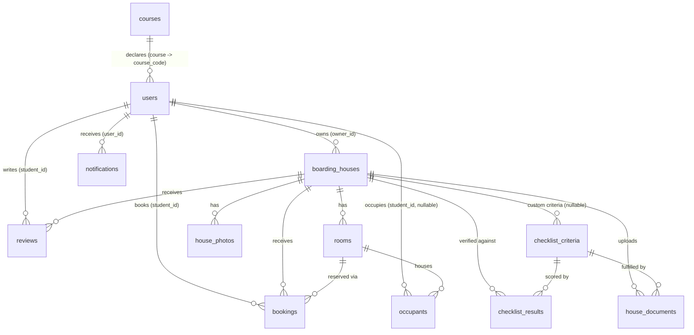

# Database Turnover Document

**System:** CSPC Boarding House Selection and Transaction Management System (PWA)
**Database Engine:** MySQL 8.0
**Database Name:** `cspc_boarding_db`
**Character Set / Collation:** `utf8mb4` / `utf8mb4_general_ci`
**Schema Source File:** `backend/config/init.sql`

---

## 1. Overview

The database consists of **12 tables** supporting four functional areas:

| Area | Tables |
|---|---|
| Identity & accounts | `users`, `courses` |
| Property & accreditation | `boarding_houses`, `rooms`, `house_photos`, `checklist_criteria`, `checklist_results`, `house_documents` |
| Transactions | `bookings`, `occupants` |
| Engagement | `reviews`, `notifications` |

All tables use the InnoDB engine with foreign keys enforced (`FOREIGN_KEY_CHECKS` is only disabled transiently during the schema import itself, per the standard `mysqldump` header). Referential integrity is enforced at the database level for every relationship described below — this is not an application-only convention.

---

## 2. Entity-Relationship Diagram



**Reading notes:**
- `checklist_criteria.house_id` is nullable — the 8 global accreditation criteria (Business Permit, Cedula, DTI, Barangay Clearance, Building Inspection, Zoning, Sanitary, Fire Safety) have `house_id = NULL` and apply to every property; a house may also have its own custom criteria rows.
- `occupants.student_id` is nullable — occupants added manually by an owner for a non-CSPC boarder (`is_non_cspc = 1`) have no linked user account.
- `bookings.room_id`, `bookings.house_id` cascade-delete; deleting a room or house removes its booking history. In practice, rooms/houses are archived rather than deleted, so this path is rarely exercised in production.

---

## 3. Data Dictionary

### 3.1 `users`
Single table for all three roles (student / owner / admin) — differentiated by the `role` column, not separate tables.

| Column | Type | Notes |
|---|---|---|
| `id` | int, PK, AUTO_INCREMENT | |
| `email` | varchar(255), UNIQUE, NOT NULL | Login identity. Students authenticate via `@my.cspc.edu.ph` Google accounts; admins via `@cspc.edu.ph`; owners via email/password or personal Gmail. |
| `password` | varchar(255) | bcrypt hash. NULL for accounts that only ever used Google OAuth. |
| `google_id` | varchar(255) | Populated for Google SSO accounts. |
| `role` | varchar(50), NOT NULL | `'student'` \| `'owner'` \| `'admin'` (enforced in application code, not a DB enum). |
| `name`, `phone`, `address` | | |
| `status` | enum: `pending`, `active`, `inactive` | `inactive` = admin-suspended; login is blocked for these accounts. |
| `student_id` | varchar(50) | CSPC student ID number, students only. |
| `sex` | varchar(20) | `'Male'` / `'Female'`, free text (not a DB enum) — set via the student profile form. Required before a student can book a room. |
| `course` | varchar(50) | FK to `courses.course_code`, `ON UPDATE CASCADE ON DELETE RESTRICT`. |
| `year_section`, `dob`, `age`, `emergency_contact`, `guardian_name`, `profile_pic` | | Student-profile fields, also reused as fallback contact info during booking. |
| `created_at` | timestamp | |

### 3.2 `courses`
Reference list of CSPC's currently-offered undergraduate programs, backing the student profile dropdown and the admin course-breakdown report.

| Column | Type | Notes |
|---|---|---|
| `id` | int, PK | |
| `course_code` | varchar(50), UNIQUE | e.g. `BSIT`. Referenced by `users.course`. |
| `course_name` | varchar(255) | Full program name. |
| `department` | varchar(10) | One of `CAS`/`CCS`/`CEA`/`CHS`/`CTHBM`/`CTDE` — drives the color-coded grouping in the admin course report. |
| `is_active` | tinyint(1) | Inactive courses (e.g. the `BHS` placeholder for one legacy unmatched student record) are hidden from the dropdown but still satisfy the FK. |

### 3.3 `boarding_houses`
The core property record, including its accreditation state and all 8 legal permits.

| Column | Type | Notes |
|---|---|---|
| `id` | int, PK | |
| `owner_id` | int, FK → `users.id`, `ON DELETE CASCADE` | |
| `name`, `img`, `img_1..3`, `location`, `barangay`, `map_link`, `price`, `rooms`, `phone_contact`, `description` | | `img_1..3` are legacy secondary-photo slots; current uploads use the separate `house_photos` table instead. |
| `amenities_free`, `amenities_paid` | longtext (JSON, CHECK `json_valid()`) | Stored as JSON arrays of strings. |
| `rating` | int | Legacy default-rating field; actual displayed rating is computed live from `reviews`. |
| `house_status` | enum: `pending`, `accredited`, `archived`, `rejected` | The property's lifecycle state. Only `accredited` houses are bookable/publicly visible. |
| `permit_business_form`, `permit_cedula`, `permit_dti`, `permit_barangay`, `permit_building`, `permit_zoning`, `permit_sanitary`, `permit_fire` | varchar(255) | File path/URL for each of the 8 mandatory legal documents. |
| `expiry_permit_*` (×8) | date | Expiry date per permit, one column per permit above. |
| `compliance_status` | enum: `active`, `warning`, `expired` | Derived from the **4 critical permits** (Business, Barangay, Sanitary, Fire) — driving auto-archive. |
| `supplementary_status` | enum: `active`, `warning`, `expired` | Derived from the **4 supplementary permits** (Cedula, DTI, Building, Zoning) — notification-only, never auto-archives. |
| `admin_comments` | text | Free-text reason, populated on manual archive/reject. |
| `document_update_pending`, `is_resubmission`, `last_updated_document` | | Track an owner's in-flight document resubmission on an already-accredited property. |
| `latitude`, `longitude` | decimal | Required (validated at submission) for every listing — powers the map views and walking-distance calculation to campus. |
| `advance_months`, `deposit_months`, `deposit_type` | | Move-in cost policy for the property (`deposit_type`: `refundable` \| `consumable`). |

### 3.4 `rooms`
| Column | Type | Notes |
|---|---|---|
| `id` | int, PK | |
| `house_id` | int, FK → `boarding_houses.id`, `ON DELETE CASCADE` | |
| `room_number` | varchar(50) | |
| `gender_type` | enum: `female`, `male` | Restricts which students' sex can book the room (`'mixed'`/`'unisex'` are handled as free-text bypass values in application logic, not additional enum members). |
| `capacity` | int | |
| `price` | decimal(10,2) | Monthly rent for this specific room. |
| `status` | enum: `available`, `occupied` | Legacy manual flag; actual availability is computed live from active `occupants` vs. `capacity`. |

### 3.5 `house_photos`
Gallery images per listing (superseded `boarding_houses.img_1..3`).

| Column | Notes |
|---|---|
| `house_id` | FK → `boarding_houses.id`, cascade delete |
| `photo_url`, `sort_order` | |

### 3.6 `checklist_criteria`
The accreditation checklist items an admin verifies. 8 global rows (`house_id IS NULL`, one per legal permit) plus optional per-house custom criteria an admin can add.

| Column | Notes |
|---|---|
| `label` | Display text, e.g. "Business Permit Application Form". |
| `is_permit_linked` | `1` = tied to a specific `boarding_houses.permit_*` column via `permit_key`; `0` = a manually-added custom criterion with no automatic document link. |
| `permit_key` | Matches a `boarding_houses` column name (e.g. `permit_business_form`), only when `is_permit_linked = 1`. |
| `house_id` | NULL = global criterion; otherwise scoped to one house. |

### 3.7 `checklist_results`
One row per (house, criterion) verification outcome during admin review.

| Column | Notes |
|---|---|
| `house_id`, `criteria_id` | FKs, both cascade delete. |
| `is_verified` | Admin's checklist tick state. |
| `verified_at` | |

### 3.8 `house_documents`
Supplementary document storage used during the accreditation review flow (distinct from the 8 fixed `permit_*` columns on `boarding_houses`, which remain the primary record for the legally-mandated documents).

| Column | Notes |
|---|---|
| `house_id`, `criteria_id` | FKs, both cascade delete. |
| `file_path`, `expiry_date` | |

### 3.9 `bookings`
A student's reservation request and its full lifecycle.

| Column | Type | Notes |
|---|---|---|
| `student_id`, `house_id`, `room_id` | int, FK, cascade delete | |
| `status` | enum: `pending`, `confirmed`, `cancelled`, `rejected`, `completed` | `pending` → owner approves → `confirmed` → owner checks the student out → `completed`. `cancelled` is student-initiated (only permitted while `pending`, or `confirmed` + unpaid PayMongo — see §5). |
| `resident_name`, `check_in_date`, `months`, `age`, `contact_number`, `emergency_contact`, `guardian_name`, `address` | | Snapshotted at booking time (not a live join to `users`), so a booking record stays accurate even if the student later edits their profile. |
| `payment_method` | varchar(50), default `'cash'` | `'cash'` \| `'paymongo'`. |
| `payment_status` | enum: `unpaid`, `paid`, `failed` | |
| `paymongo_session_id`, `paymongo_payment_id` | | PayMongo Checkout Session tracking. |
| `amount` | decimal(10,2) | Total for the full stay (`monthly_rent × months`). |
| `monthly_rent` | decimal(10,2) | Snapshotted room price at booking time. |
| `booking_date` | timestamp | Submission timestamp — distinct from `check_in_date` (the requested move-in date). |
| `extension_months`, `is_extension_requested` | | Stay-extension request state. |

### 3.10 `occupants`
The authoritative "who is actually living where right now" record — **distinct from `bookings`**. A `bookings` row becomes an `occupants` row only once occupancy is real: immediately on owner approval for cash, or only after payment clears for PayMongo. This table, not `bookings`, is what every occupancy count, room-availability check, and the emergency residency registry reads from.

| Column | Type | Notes |
|---|---|---|
| `room_id` | int, FK → `rooms.id`, `ON DELETE CASCADE` | |
| `student_id` | int, FK → `users.id`, `ON DELETE SET NULL`, nullable | NULL for manually-added non-CSPC boarders. |
| `reference_no` | varchar(50) | `REF-####`, derived from the originating `bookings.id`. |
| `name`, `age`, `address`, `contact_number`, `emergency_contact`, `guardian_name` | | Snapshotted, same rationale as `bookings`. |
| `check_in_date`, `check_out_date` | date | `check_out_date IS NULL` = currently active resident. |
| `months`, `amount` | | |
| `payment_status` | varchar(50), default `'Not Paid'` | Free text (`'Paid'` / `'Not Paid'`) — note the differing casing convention from `bookings.payment_status`, a pre-existing inconsistency between the two tables. |
| `payment_method` | varchar(20), default `'cash'` | `'cash'` \| `'paymongo'` — records *how* this resident paid, for reporting. |
| `is_non_cspc` | tinyint(1) | `1` = manually added by the owner outside the booking flow (e.g. a boarder who isn't a CSPC student); excluded from all CSPC-specific counts and reports. |

### 3.11 `reviews`
| Column | Notes |
|---|---|
| `house_id`, `student_id` | FKs, both cascade delete. |
| `rating` | 1–5. |
| `comment` | |

### 3.12 `notifications`
Shared inbox table for all three roles.

| Column | Notes |
|---|---|
| `user_id` | FK → `users.id`, cascade delete. |
| `message` | Plain text; the leading keyword (e.g. `RESERVATION SUBMITTED:`, `WARNING:`, `ALERT:`) drives the icon/category shown in the UI — this is a text-convention, not a separate `type` column. |
| `link`, `is_read` | |

---

## 4. Business Rules Enforced Outside the Schema

The database enforces structural integrity (foreign keys, enums, the JSON-validity checks on amenities), but several rules that matter for data correctness live in application code, not constraints:

- A student may only have one active occupancy and one confirmed booking at a time (`backend/routes/student.js`).
- `bookings` → `occupants` promotion timing (cash = immediate on approval; PayMongo = only after payment) — see §3.10.
- Critical vs. supplementary permit tiering for auto-archiving (`backend/config/complianceManager.js`).
- Room capacity and gender-matching checks at booking time.

Anyone querying this database directly (rather than through the application) should be aware that, e.g., a `bookings` row with `status = 'confirmed'` does **not** by itself guarantee a matching `occupants` row exists — check `payment_status` and `payment_method` together, per §3.10.

---

## 5. Producing a Database Dump / Backup

The schema itself (structure only, no data) is version-controlled at `backend/config/init.sql` and is regenerated automatically on every fresh container start.

To produce a **full backup including live data** (for turnover or disaster recovery), run against the production database:

```bash
mysqldump -h <host> -u <user> -p --databases cspc_boarding_db > cspc_boarding_db_backup_$(date +%Y%m%d).sql
```

To restore from a backup:

```bash
mysql -h <host> -u <user> -p < cspc_boarding_db_backup_YYYYMMDD.sql
```

**Recommendation:** take this dump immediately before turnover, and store it alongside this document as the official "Database Turnover" deliverable snapshot.

---

## 6. Sample / Seed Data

`backend/config/init.sql` seeds one bootstrap admin account and the 28-row `courses` reference table (CSPC's official program list) on first run — no other sample/demo data is included in the shipped schema. Any student, owner, boarding house, booking, or occupant data present in a running instance is real data entered through the application, not seed data.
