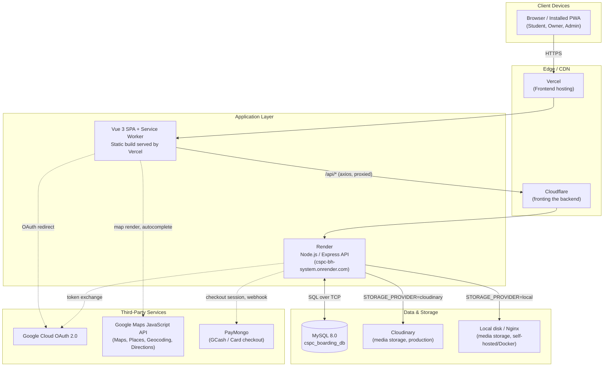

# System Architecture

**System:** CSPC Boarding House Selection and Transaction Management System
**Stack:** MEVN (MySQL, Express.js, Vue.js 3, Node.js) + Progressive Web App

---

## 1. Architecture Overview



---

## 2. Deployment Topology

Two independent deployment paths exist for this system, both from the same codebase:

### 2.1 Production (cloud)
| Component | Host | Notes |
|---|---|---|
| Frontend | **Vercel** | Builds `frontend/` via `vite build`; serves the static SPA + service worker. Auto-deploys on push to `main`. |
| Backend | **Render**, behind **Cloudflare** | Runs `backend/` as a persistent Node process (`node index.js`). Auto-deploys on push to `main`. HTTPS is enforced both by Cloudflare/Render's edge and by app-level middleware (`backend/index.js`) as defense-in-depth. |
| Database | **External managed MySQL 8.0** | Separate from both Vercel and Render — neither platform's redeploys touch it. Accessed directly for administration (e.g. via MySQL Workbench). |
| Media storage | **Cloudinary** | Set via `STORAGE_PROVIDER=cloudinary`. Necessary in production because Render's filesystem is ephemeral — anything written to local disk is lost on every redeploy/restart. |

### 2.2 Self-hosted (Docker Compose)
For local development, demonstration, or on-premises institutional hosting, `docker-compose.yml` defines a fully self-contained 4-container stack:

| Container | Image / Base | Port | Role |
|---|---|---|---|
| `cspc_frontend_app` | Node 20 (build) → Nginx (serve) | 80 | Compiles and serves the Vue SPA. |
| `cspc_backend_api` | Node 18-alpine | 3000 | Express API. |
| `cspc_mysql_db` | `mysql:8.0` | 3306 | Seeded automatically from `backend/config/init.sql` on first start. |
| `cspc_media_storage` | `nginx:alpine` | 8080 | Serves uploaded files from a shared Docker volume when `STORAGE_PROVIDER=local`. |

This path requires no external cloud accounts for hosting or storage (Cloudinary and Vercel/Render are bypassed entirely) — only the third-party API keys below remain necessary regardless of hosting choice, since they're external services the app calls out to, not hosting infrastructure.

---

## 3. Application Layers

### 3.1 Frontend — Vue 3 SPA (`frontend/`)
- **Framework:** Vue 3 (Composition API, `<script setup>`), Vue Router 4, Vite 8.
- **Styling:** Tailwind CSS 3.
- **State:** No global store (Pinia/Vuex) — each view manages its own local state via `ref`/`computed`; cross-cutting concerns (auth token, current user) are read from `sessionStorage` directly where needed.
- **PWA layer:** `vite-plugin-pwa` generates the service worker and manifest at build time. Runtime caching strategies (`StaleWhileRevalidate` for listing data, `CacheFirst` for images) are configured in `frontend/vite.config.js`, allowing the app to install to a home screen and retain partial functionality offline.
- **Role-based routing:** a single `router/index.js` defines all routes with a `meta.role` field; a global `beforeEach` guard blocks cross-role access (a student cannot navigate to an owner or admin route, etc.).

### 3.2 Backend — Express API (`backend/`)
- **Framework:** Express 5, ES modules throughout.
- **Structure:** one router file per domain area under `backend/routes/` (`auth`, `student`, `owner`, `admin`, `boardingHouses`, `payment`, `notifications`), mounted in `backend/index.js`.
- **Auth:** JWT-based sessions (`jsonwebtoken`), issued on login and verified per-request via middleware in `routes/auth.js`. Google OAuth is handled via Passport (`config/passport.js`), domain-restricted per role (`@my.cspc.edu.ph` for students, `@cspc.edu.ph` for admins).
- **Database access:** `mysql2/promise` connection pool (`config/db.js`); multi-step writes use explicit transactions (`beginTransaction`/`commit`/`rollback`) rather than relying on autocommit, particularly in the booking and accreditation-approval flows.
- **Scheduled jobs:** `node-cron` runs two daily jobs from `backend/index.js` — the compliance/expiry sweep (`config/complianceManager.js`) and orphaned-upload cleanup (`config/upload.js`), plus a 14-minute keep-alive ping to prevent Render's free-tier instance from idling out.
- **File uploads:** `multer` (memory storage) buffers the upload, then `config/upload.js` routes the buffer to either Cloudinary or local disk based on `STORAGE_PROVIDER`, returning a uniform URL/path either way so calling code never needs to know which backend is active.

### 3.3 Database — MySQL 8.0
See `docs/04-database-turnover.md` for the full schema, ERD, and data dictionary.

---

## 4. Key Cross-Cutting Flows

### 4.1 Authentication
1. Student/Admin: "Continue with Google" → Google OAuth consent → Passport verifies the account's email domain matches the expected role → backend issues a JWT → frontend stores it in `sessionStorage`.
2. Owner: email + password (bcrypt-verified) **or** Google OAuth with a personal Gmail — same JWT issuance either way.
3. Every subsequent request carries the JWT in an `Authorization` header; `authenticateToken` middleware verifies it and attaches `req.user`.
4. **Idle session timeout:** a 30-minute client-side inactivity timer (`frontend/src/App.vue`) clears the session and redirects to login if no mouse/keyboard/touch/navigation activity occurs, independent of the JWT's own longer expiry.

### 4.2 Accreditation → Booking → Occupancy pipeline
```mermaid
sequenceDiagram
    participant O as Owner
    participant A as Admin
    participant S as Student
    participant DB as Database

    O->>DB: Submit 8 legal documents (boarding_houses.permit_*)
    A->>DB: Review checklist, Approve → house_status = 'accredited'
    S->>DB: Submit booking (bookings, status = 'pending')
    O->>DB: Approve booking → bookings.status = 'confirmed'
    alt payment_method = cash
        DB->>DB: occupants row created immediately
    else payment_method = paymongo
        S->>DB: Complete PayMongo checkout
        DB->>DB: occupants row created only after payment confirmed
    end
    Note over DB: Compliance cron re-checks permit expiry daily;<br/>critical-permit expiry auto-archives the house
```

### 4.3 Third-Party Service Touchpoints
| Service | Where it's called | Purpose |
|---|---|---|
| Google Cloud OAuth 2.0 | `backend/config/passport.js`, `routes/auth.js` | Login for all three roles. |
| Google Maps JavaScript API | Multiple `frontend/src/views/**` | Interactive maps, address autocomplete (owner listing setup), reverse geocoding, walking-distance directions to campus. |
| PayMongo | `backend/routes/payment.js` | GCash/Card checkout sessions and webhook-driven payment confirmation. |
| Cloudinary | `backend/config/upload.js` | Production media storage (conditional on `STORAGE_PROVIDER`). |

---

## 5. Environment Configuration

Behavior that differs between environments is controlled entirely by environment variables — no code branches on "am I in production," everything reads from `process.env`:

| Variable | Purpose |
|---|---|
| `STORAGE_PROVIDER` | `local` \| `cloudinary` |
| `DB_HOST`, `DB_USER`, `DB_PASSWORD`, `DB_NAME`, `DB_PORT` | Database connection. |
| `JWT_SECRET` | Token signing key. |
| `FRONTEND_URL` | Used to build OAuth callback and PayMongo redirect URLs correctly regardless of which frontend origin is calling. |
| `GOOGLE_CLIENT_ID`, `GOOGLE_CLIENT_SECRET`, `GOOGLE_CALLBACK_URL` | OAuth app credentials. |
| `CLOUDINARY_CLOUD_NAME`, `CLOUDINARY_API_KEY`, `CLOUDINARY_API_SECRET` | Only required when `STORAGE_PROVIDER=cloudinary`. |
| `PAYMONGO_SECRET_KEY`, `PAYMONGO_WEBHOOK_SECRET` | Payment processing. |
| `VITE_GOOGLE_MAPS_API_KEY` | Frontend-side, baked in at build time (not a runtime secret — Maps API keys are domain-restricted, not confidential). |

See `backend/.env.example` and `frontend/.env` for the full reference list of variables each side expects.
